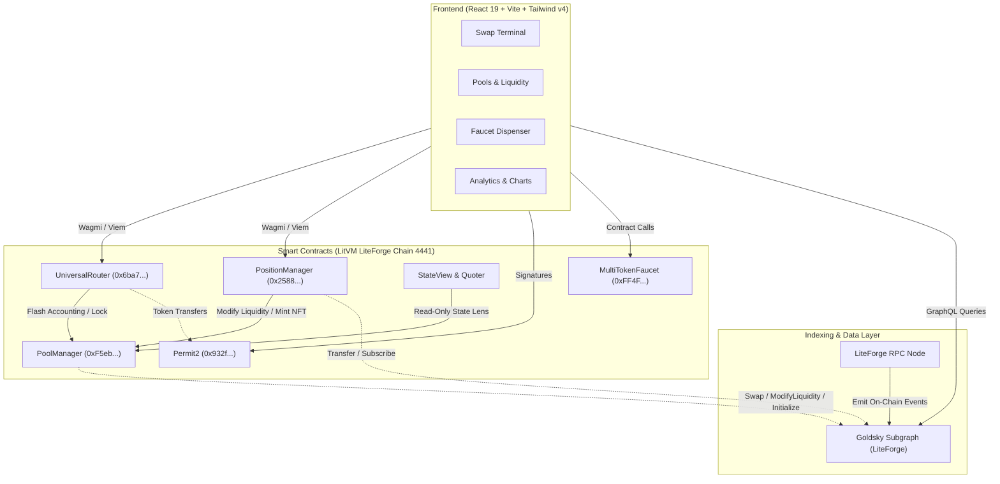

# Meridian 🌐

> **Next-Generation Concentrated Liquidity AMM & Decentralized Exchange powered by Uniswap v4 on LitVM LiteForge**

[-6366f1?style=flat-square)](https://explorer.testnet.liteforge.zeeve.net)
[](https://soliditylang.org/)
[](https://getfoundry.sh/)
[](https://vitejs.dev/)
[](https://wagmi.sh/)
[](https://api.goldsky.com/)

---

## 📖 Overview

**Meridian** is a decentralized exchange (DEX) and automated market maker (AMM) built on the groundbreaking **Uniswap v4** protocol architecture and deployed to **LitVM LiteForge**, a high-performance zero-knowledge EVM execution network.

By harnessing Uniswap v4's **Singleton PoolManager**, **flash accounting**, and **transient storage (EIP-1153)**, Meridian achieves unprecedented gas efficiency, zero token hops overhead, and dynamic liquidity management. The platform features an intuitive, modern trading terminal with real-time price charts, pool analytics, concentrated liquidity management, and a native multi-token faucet.

---

## ✨ Key Features

- **⚡ Flash-Accounting Token Swapping**:
  Executes low-slippage trades using Uniswap v4's `UniversalRouter`, optimizing internal balance deltas via `SWAP_EXACT_IN_SINGLE`, `SETTLE_ALL`, and `TAKE_ALL` operations.
- **🎯 Concentrated Liquidity Provisioning**:
  Enables liquidity providers (LPs) to allocate capital within customized price ranges, maximizing fee earnings and capital efficiency through the `PositionManager` (ERC-721 LP NFTs).
- **🔒 Seamless Permit2 Approvals**:
  Integrated with Uniswap's `Permit2` protocol for secure, single-signature, and time-bounded token allowances, minimizing multi-step token approvals.
- **🏊 Dynamic Pool Creation**:
  Permissionless initialization of v4 liquidity pools with customizable fee tiers (`0.01%`, `0.05%`, `0.30%`, `1.00%`), tick spacings, and hook extensibility.
- **📊 Real-Time Analytics & Charts**:
  Interactive trading charts powered by TradingView's `Lightweight Charts`, backed by an indexing subgraph that aggregates TVL, volume, fees, APR, and transaction history.
- **🚰 On-Chain Multi-Token Faucet**:
  A custom, rate-limited smart contract allowing users to claim a bundle of testnet tokens (`tUSDT`, `tLTC`, `STPT`, `GENOME`, `MC`, `ZYN`) in a single transaction.
- **👤 Portfolio & Position Management**:
  Comprehensive profile hub to monitor active LP positions, track collected and uncollected fees, and inspect recent wallet activity.

---

## 🏗️ Architecture

Meridian consists of three tightly coupled components:



### Protocol Flow
1. **Trading Flow**: Users submit swap requests through the frontend. The transaction routes through `UniversalRouter`, interacts with `Permit2` for allowance, and executes atomic delta settlements against the singleton `PoolManager`.
2. **Liquidity Flow**: LPs select tick bounds and submit liquidity through `PositionManager`, which coordinates position NFT minting, tick updates, and fee tracking.
3. **Analytics Flow**: On-chain events (`Swap`, `ModifyLiquidity`, `Initialize`, `Transfer`) are indexed by our subgraph on Goldsky, serving GraphQL queries for 24h volume, TVL, and candle data.

---

## 🌐 Network Information & Deployments

### LitVM LiteForge Testnet

| Parameter | Value |
| :--- | :--- |
| **Network Name** | LitVM LiteForge |
| **Chain ID** | `4441` |
| **Native Currency** | `zkLTC` (18 decimals) |
| **RPC Endpoint** | `https://rpc.testnet.liteforge.zeeve.net/` |
| **Block Explorer** | [https://explorer.testnet.liteforge.zeeve.net](https://explorer.testnet.liteforge.zeeve.net) |
| **Gas Faucet** | [https://faucet.testnet.liteforge.zeeve.net/](https://faucet.testnet.liteforge.zeeve.net/) |
| **Network Portal** | [https://testnet.litvm.com](https://testnet.litvm.com) |

---

### Core Smart Contract Addresses

All core contracts are deployed, verified, and operational on LitVM LiteForge (Chain ID `4441`):

| Contract | Address | Description |
| :--- | :--- | :--- |
| **PoolManager** | [`0xF5ebb911f16F7C6EF0F41459506729035Ca40B2E`](https://explorer.testnet.liteforge.zeeve.net/address/0xF5ebb911f16F7C6EF0F41459506729035Ca40B2E) | Core singleton vault holding all pool balances & state |
| **UniversalRouter** | [`0x6ba7ad84608C03888b16bF57a8aee7e59035aAE5`](https://explorer.testnet.liteforge.zeeve.net/address/0x6ba7ad84608C03888b16bF57a8aee7e59035aAE5) | Primary execution router for exact-in and exact-out swaps |
| **PositionManager** | [`0x2588E5Df6c621e7FCc05707bFb337643D12d35d2`](https://explorer.testnet.liteforge.zeeve.net/address/0x2588E5Df6c621e7FCc05707bFb337643D12d35d2) | ERC-721 Concentrated Liquidity position NFT manager |
| **Permit2** | [`0x932f86Fd415107802892B7e1FdB1414b3331c494`](https://explorer.testnet.liteforge.zeeve.net/address/0x932f86Fd415107802892B7e1FdB1414b3331c494) | Next-gen token approval and signature transfer router |
| **V4Quoter** | [`0xDCc1cd16B492f55d32B455D3B6b2Dd8B83dCcA4f`](https://explorer.testnet.liteforge.zeeve.net/address/0xDCc1cd16B492f55d32B455D3B6b2Dd8B83dCcA4f) | Lens contract for computing off-chain swap quotes |
| **StateView** | [`0xa3ac6218481cd6852a77FC7d46bf87d1D3e3C5B3`](https://explorer.testnet.liteforge.zeeve.net/address/0xa3ac6218481cd6852a77FC7d46bf87d1D3e3C5B3) | Read-only external accessor for pool liquidity and slot0 state |
| **PositionDescriptor** | [`0x888dDa033C98DDF87401B7c3E052c91144d56731`](https://explorer.testnet.liteforge.zeeve.net/address/0x888dDa033C98DDF87401B7c3E052c91144d56731) | On-chain metadata and SVG renderer for LP NFTs |
| **WETH** | [`0xB4F5FE33a7bf2fF57d6aB9A59061C7Bb27462f2C`](https://explorer.testnet.liteforge.zeeve.net/address/0xB4F5FE33a7bf2fF57d6aB9A59061C7Bb27462f2C) | Canonical Wrapped Ether utility contract |
| **MultiTokenFaucet** | [`0xFF4F9485CabF80a4CB77243dB138296a12A2A0ce`](https://explorer.testnet.liteforge.zeeve.net/address/0xFF4F9485CabF80a4CB77243dB138296a12A2A0ce) | Community faucet distributing testnet tokens with cooldown |

---

### Supported Tokens

The testnet environment features 6 custom ERC-20 tokens. Note that addresses for `tUSDT` and `tLTC` were pre-mined using CREATE2 salts to guarantee predictable `currency0 < currency1` lexicographical orderings:

| Asset | Symbol | Decimals | Address | Faucet Dispense |
| :--- | :--- | :---: | :--- | :---: |
| **Tether USD (Test)** | `tUSDT` | 6 | [`0x0188e0ce0804D5f431AB70ee94024b68a46bBA71`](https://explorer.testnet.liteforge.zeeve.net/token/0x0188e0ce0804D5f431AB70ee94024b68a46bBA71) | 5,000 |
| **Litecoin (Test)** | `tLTC` | 18 | [`0x01f9b27f4C3dE3511983C2f90b0A6Af59863cdbD`](https://explorer.testnet.liteforge.zeeve.net/token/0x01f9b27f4C3dE3511983C2f90b0A6Af59863cdbD) | 50 |
| **STPT** | `STPT` | 18 | [`0xF56b200f4007FF00B92dfd2C87183a20bdf7EE75`](https://explorer.testnet.liteforge.zeeve.net/token/0xF56b200f4007FF00B92dfd2C87183a20bdf7EE75) | 1,000 |
| **GENOME** | `GENOME` | 18 | [`0xf2FD1F1171C902a69B30b0cd75e2d0e7C499eEfe`](https://explorer.testnet.liteforge.zeeve.net/token/0xf2FD1F1171C902a69B30b0cd75e2d0e7C499eEfe) | 2,000 |
| **MistCoin** | `MC` | 18 | [`0x5a6285C084B4b31eFC4562481D03b398d1715C47`](https://explorer.testnet.liteforge.zeeve.net/token/0x5a6285C084B4b31eFC4562481D03b398d1715C47) | 10,000 |
| **ZyneCoin** | `ZYN` | 18 | [`0x666301A904602452b6172f9F5070832767B12DF1`](https://explorer.testnet.liteforge.zeeve.net/token/0x666301A904602452b6172f9F5070832767B12DF1) | 5,000 |

---

## 📁 Repository Structure

```text
Meridian/
├── package.json             # Root monorepo scripts (Bun workspace runner)
├── frontend/                # React 19 + Vite web application
│   ├── src/
│   │   ├── app/             # Application routes (Swap, Pools, Positions, Faucet, Profile)
│   │   ├── components/      # UI components (Navbar, Footer, TokenSelector, Toast, etc.)
│   │   ├── hooks/           # Web3 hooks (useSwap, usePositions, useApproval, useQuote)
│   │   ├── config/          # Token and network definitions
│   │   ├── lib/             # Constants, chain specs, and Subgraph queries
│   │   └── utils/           # Uniswap v4 tick and liquidity math calculations
│   └── vite.config.ts       # Vite bundler configuration
│
├── foundry/                 # Foundry smart contract workspace
│   ├── src/                 # Custom contracts (MultiTokenFaucet, MockERC20)
│   ├── script/              # Deployment and CREATE2 salt-mining scripts
│   ├── test/                # Local and mainnet/testnet fork test suites
│   └── foundry.toml         # Foundry configuration, RPC endpoints, and solc options
│
└── subgraph/                # Graph Protocol indexer configuration
    ├── schema.graphql       # GraphQL schema for Pools, Swaps, Ticks, Positions
    ├── subgraph.yaml        # Data sources, handlers, and block ranges
    └── src/mappings/        # AssemblyScript event handlers (PoolManager, PositionManager)
```

---

## 🚀 Getting Started

### Prerequisites

Ensure you have the following installed on your machine:
- [Bun](https://bun.sh/) (recommended) or [Node.js](https://nodejs.org/) (v20+)
- [Foundry](https://book.getfoundry.sh/getting-started/installation) (`forge`, `cast`)
- [Git](https://git-scm.com/)

---

### 1. Frontend Setup

The frontend connects to LitVM LiteForge, queries the Goldsky Subgraph, and utilizes Reown AppKit for wallet connections.

```bash
# Navigate to the frontend directory
cd frontend

# Install dependencies
bun install

# Configure environment variables
cp .env.example .env # (or create .env with required keys)
```

#### Frontend Environment Variables (`frontend/.env`)
```bash
VITE_WALLETCONNECT_PROJECT_ID="your_reown_walletconnect_project_id"
VITE_REOWN_PROJECT_ID="your_reown_walletconnect_project_id"
```

#### Run Development Server
```bash
bun dev
```
Open [http://localhost:3000](http://localhost:3000) in your browser.

#### Build for Production
```bash
bun run build
bun run preview
```

---

### 2. Smart Contracts (Foundry)

The `foundry/` directory contains all deployment scripts, verification setups, and fork tests.

```bash
cd foundry

# Build contracts
forge build

# Run unit and faucet tests
forge test --match-contract MultiTokenFaucetTest -vvv

# Run forked swap integration test on LitVM LiteForge
forge test --match-contract ForkSwapTest -vvv --fork-url https://rpc.testnet.liteforge.zeeve.net/
```

#### Environment Variables (`foundry/.env`)
```bash
ADDRESS_TO_MINT_TO="0x05bb580503eace5bb21b3be5e2cd917653a022b9"
POOLMANAGER_ADDRESS="0xF5ebb911f16F7C6EF0F41459506729035Ca40B2E"
UNIVERSALROUTER_ADDRESS="0x6ba7ad84608C03888b16bF57a8aee7e59035aAE5"
POSITION_MANAGER_ADDRESS="0x2588E5Df6c621e7FCc05707bFb337643D12d35d2"
PERMIT2_ADDRESS="0x932f86Fd415107802892B7e1FdB1414b3331c494"
QUOTER="0xDCc1cd16B492f55d32B455D3B6b2Dd8B83dCcA4f"
STATEVIEW_ADDRESS="0xa3ac6218481cd6852a77FC7d46bf87d1D3e3C5B3"
MULTI_TOKEN_FAUCET_ADDRESS="0xFF4F9485CabF80a4CB77243dB138296a12A2A0ce"
```

#### Deployment Scripts
Deployment scripts are located in `foundry/script/`:
```bash
# 1. Deploy Tokens (or mine custom salts)
forge script script/DeployTokens.s.sol --rpc-url LitVM_LiteForge --broadcast

# 2. Deploy PoolManager
forge script script/DeployPM.s.sol --rpc-url LitVM_LiteForge --broadcast

# 3. Deploy Permit2 & PositionManager
forge script script/DeployPermit2.s.sol --rpc-url LitVM_LiteForge --broadcast
forge script script/DeployPositionManager.s.sol --rpc-url LitVM_LiteForge --broadcast

# 4. Deploy UniversalRouter & StateView
forge script script/DeployUniversalRouter.s.sol --rpc-url LitVM_LiteForge --broadcast
forge script script/DeployStateView.s.sol --rpc-url LitVM_LiteForge --broadcast

# 5. Deploy & Fund MultiTokenFaucet
forge script script/DeployMultiTokenFaucet.sol --rpc-url LitVM_LiteForge --broadcast
forge script script/FundFaucet.s.sol --rpc-url LitVM_LiteForge --broadcast
```

---

### 3. Subgraph Indexer

The subgraph tracks liquidity initialization, swaps, and position modifications.

```bash
cd subgraph

# Install dependencies
yarn install

# Generate TypeScript types from GraphQL schema & ABIs
yarn codegen

# Build the WebAssembly mapping output
yarn build

# Deploy to Goldsky (or custom Graph node)
goldsky subgraph deploy meridian-subgraph/1.0.1 --path .
```

#### Live Subgraph GraphQL Endpoint:
```
https://api.goldsky.com/api/public/project_cmr13n1yva85401ts7mu74i0z/subgraphs/meridian-subgraph/1.0.1/gn
```

---

## 🔬 Technical Highlights & Mechanisms

### 1. Uniswap v4 Flash Accounting & UniversalRouter
Unlike Uniswap v3 which transfers tokens after every intermediate swap step, Uniswap v4 locks the `PoolManager` and operates via balance deltas:
- The router initiates an `execute` call with encoded command byte `V4_SWAP`.
- The actions `SWAP_EXACT_IN_SINGLE`, `SETTLE_ALL`, and `TAKE_ALL` allow trading between any token pair, only transferring net owed balances at the conclusion of the execution block.

### 2. CREATE2 Token Salt Mining
In Uniswap v4 pools, tokens are strictly indexed by address order:
$$\text{currency0} < \text{currency1}$$
To guarantee clean address boundaries for base quote pairs such as `tUSDT` and `tLTC`, offline mining scripts (`MineTUSDT.s.sol`, `MineTLTC.s.sol`) searched 10,000,000+ salt nonces until deterministic addresses beginning with `0x01...` were generated.

### 3. Multi-Action Liquidity Management
Positions in Uniswap v4 are managed through the ERC-721 `PositionManager`. LPs can:
- **Mint**: Supply concentrated liquidity within lower and upper ticks.
- **Increase / Decrease**: Dynamically inject or withdraw liquidity from existing position IDs.
- **Collect Fees**: Harvest accrued trading fees on-demand.

---

## 🛠️ Tech Stack

- **Smart Contracts**: Solidity `0.8.26` / `0.8.28` / `0.8.37`, Foundry, OpenZeppelin Contracts, Uniswap v4 Core & Periphery, Permit2, UniversalRouter.
- **Frontend**: React 19, TypeScript, Vite, Tailwind CSS v4, Wagmi v3, Viem, Reown AppKit, Lucide React, TradingView Lightweight Charts.
- **Data & Indexing**: Graph Protocol, AssemblyScript, Goldsky Indexer, GraphQL.

---

## 📄 License

This repository is licensed under the [MIT License](LICENSE) or applicable upstream Uniswap v4 licenses (BUSL-1.1 / GPL-3.0-or-later where designated in submodules).
